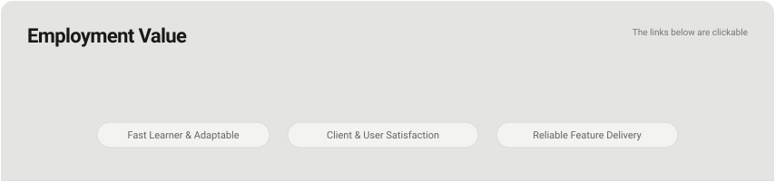

 

# Engineering Mindset & Value for Employers

---

## Active Rigor in an AI-Accelerated Era

With generative tools writing a high volume of modern code, too many developers take a passive back seat: leading to hallucinations, security vulnerabilities, and bloated architectures.

* **My approach:** I use AI as an accelerator, but never as a substitute for deep systems comprehension.
* Having built low-level Windows utilities and tamper-resistant mechanics in C#, I inspect what sits under the hood: verifying memory boundaries, auditing dependencies, and ensuring code is secure and deterministic before it ever reaches production.

---

## Practical, High-Efficiency On-Device ML

Cloud API calls introduce recurring costs, latency bottlenecks, and data privacy concerns.

* When tasks require intelligence, I explore task-specific, on-device small language models (SLMs).
* By fine-tuning compact architectures locally, I help teams build features that are faster, cost zero tokens to query, and keep sensitive company and user data entirely private.

---

## Technical Scope & Polyglot Adaptability

* **Core:** C#/.NET, Windows system APIs, and desktop architecture.
* **ML & Scripting:** Python for data pipelines, model evaluation, and fine-tuning.
* **Web & Runtime:** Modern JavaScript and TypeScript for browser internals and responsive tools.
* **Mindset:** I select the tool that best fits the hardware and cognitive constraints of the problem, rather than forcing everything into one language.

---

## Target Roles

I am actively seeking **Software Engineering Internships, Junior Developer positions, or contract engineering roles** where I can contribute my discipline, solve hard infrastructure or application challenges, and learn from experienced engineers.

---

## Connect & Inquiries

* **GitHub:** [@Detractless](https://github.com/Detractless)
* **Resume:** To be added

