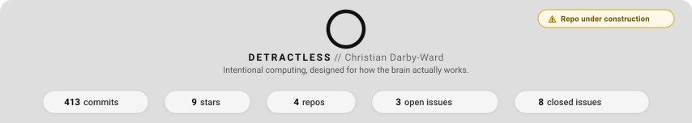

---

## The Mission

Technology has done immense good for the world, but modern computing often works against human psychology: introducing cognitive fatigue, constant distraction, and mental friction. My goal is to tip the scale back in favor of human intentionality.

I design and build software centered around how the brain actually functions:

* **Relieving Mental Pressure:** Computers should match human cognitive bandwidth, accelerating meaningful work without overwhelming working memory.
* **Defeating Willpower Depletion:** Willpower is finite. Instead of expecting people to fight addictive algorithms with pure self-control, I build reliable, tamper-resistant commitment systems for reading, training, digital boundaries, and daily habits.
* **Frictionless Exit:** Creating software that makes stepping away from screens and digital noise as effortless as entering them, allowing people to finally *Leko* the struggle, and *Atlas*t reclaim their focus.

I study **Software Development and Psychology** at Kennesaw State University to ensure my systems are both technically robust and psychologically grounded.

---

## Collaborators and Builders

I am actively looking to connect with builders, designers, and thinkers who share a similar philosophy toward intentional computing:

* **Kindred Spirits & Builders:** People who want to build commitment devices, ergonomic workflows, and interfaces that actively respect human attention and cognitive limits.
* **Open Collaboration:** Whether you are working on distraction-blocking utilities, local/on-device AI tooling, or cognitive research, reach out.

---

## Connect

* **GitHub:** [@Detractless](https://github.com/Detractless)
* **Resume:** To be added

